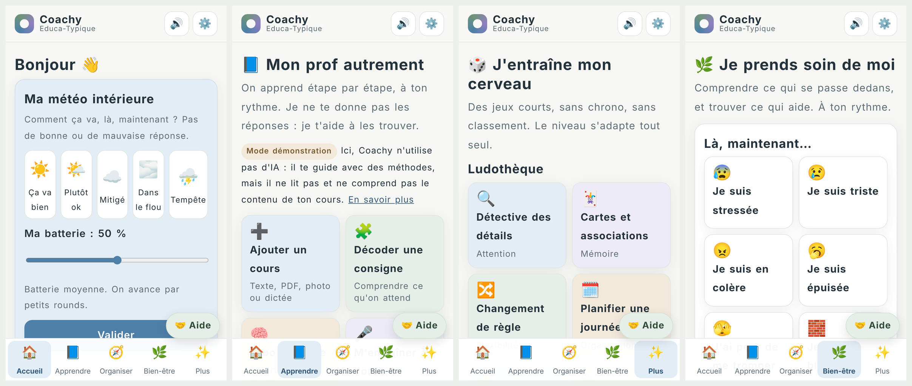

# Coachy 2.0 — Educa-Typique

Le compagnon de l'ado pour **apprendre, s'organiser, prendre soin de soi et mieux se connaître**.
Prototype V1 « profil pilote » (3e · DNB & CFG), construit à partir de Moi & Coachy V1.



- **Adresse (une fois publié)** : `/coachy-2/` sur le site (Vercel ou GitHub Pages).
- **En local** : double-clic sur `coachy-2/index.html` (tout marche, sauf le mode IA).
- **Installable** sur iPhone, iPad et Android (Partager → « Sur l'écran d'accueil »), **hors-ligne** après la 1re visite.
- **100 % local** : tout est stocké sur l'appareil (clé `coachy2`). Rien n'est envoyé, sauf en mode IA (voir plus bas).

## Coachy V1 est préservé

`moi-et-coachy/` n'a **pas été modifié**. Coachy 2.0 vit à côté et peut **reprendre les notes de la V1**
(prénom, découvertes, phrase de secours, plan SI/ALORS) — chaque découverte reprise doit être validée par l'ado.

### Inventaire de la V1 et ce qu'il est devenu

| Coachy V1 | Coachy 2.0 |
|---|---|
| Batterie, check « avant décollage », mission, présence, round 10/20/30 min | Conservés dans **Je m'organise › Lancer un round** + 5 min et « sans minuteur » ; durée proposée selon le profil et l'énergie |
| Boutons Je bloque / Je décroche / Ça monte / Pause | 7 boutons contextuels (+ Je ne comprends pas, J'ai oublié, Je ne sais pas commencer), chacun avec une intervention courte et un outil |
| Parking à pensées, Vidage RAM, reset (bulle, mouvement, eau, air) | Conservés + relaxation, 5-4-3-2-1, re-scan « est-ce que ça m'a aidé ? » |
| Checkpoint + question « intelligente » + « garder une découverte » | Conservé ; les découvertes vont dans **Mon mode d'emploi** après validation |
| Suivi hebdo, export texte | Météo intérieure quotidienne + historique, progression hebdo, export/import JSON complet |
| Mon Mode d'emploi (crise), Mon discernement | Restent dans la V1 (liens depuis Coachy 2.0) ; Coachy 2.0 ajoute le carnet en 10 chapitres |

## Ce qui fonctionne (et ce qui est en démonstration)

| Espace | Fonctionnel hors-ligne | Limites assumées |
|---|---|---|
| 🏠 Tableau de bord | Météo intérieure, batterie, mission du jour (suggestions), rappels mémoire, découvertes à valider, progression, « Aide » | — |
| 📘 Mon prof autrement | Ajout de cours (texte, **PDF**, dictée), photo + astuce « Texte en direct », **décodeur de consignes**, parcours en **9 étapes**, indices de méthode progressifs, cartes mémoire auto-proposées, fiche visuelle, carte mentale, cours audio, oral (enregistrement + grille), tableau brevet/CFG | **Sans IA, Coachy ne comprend pas le contenu du cours** : c'est écrit dans l'appli. Explications, indices sur l'exercice et lecture des photos = mode IA |
| 🧠 Labo mémoire | Réactivation espacée (immédiat, 30 min facultatif, J+1, J+3, J+7, J+14, J+30 — réglables), 5 niveaux de réussite, questions de transfert, statut « acquis durable » seulement après réussite autonome à J+7 (+ transfert), plan de contrôle J-7/J-3/J-1 | Pas de notifications push (le rappel apparaît à l'ouverture) |
| 🧭 Je m'organise | Rounds, 7 boutons contextuels, découpage (modèles), parking, routines (cartable, matin, soir, stage…), planning sans culpabilité (« reporter » / « laisser partir »), relecture guidée avec lecture audio du texte | — |
| 🎲 Ludothèque | 9 jeux + 8 situations « vraie vie », tous jouables : détective des détails, mémoire, changement de règle, planifier une journée, consignes, prix/promos, émotions, situations sociales, quiz de ses cartes ; boulangerie, rendre la monnaie, comparer des prix, horaires de bus, trajet, cartable, stage, consignes pro | Sans chrono, sans classement ; niveau qui monte après 3 réussites, réglable |
| 🌿 Je prends soin de moi | 8 parcours « Je suis… » (validation → corps → outil → besoin → re-scan), thermomètre, roue des émotions, radar, carnet des réussites, pensées pièges (TCC), stress des examens, confiance | Mentions 3114 / 119 / 112 ; aucun diagnostic |
| 🌸 Mon jardin intérieur | Version universelle (pauses, gratitude, respiration) ; ressources spirituelles **désactivées par défaut** : invocations coraniques (arabe, phonétique, traduction, référence), dhikr sans objectif chiffré, méditations sur 5 Noms | Audio arabe = voix de l'appareil si installée, sinon message honnête. **Tous les contenus sont marqués « en attente de relecture par Nawel »** |
| 🪞 Mon mode d'emploi | 10 chapitres, découvertes Coachy → validation par l'ado, carte d'identité cognitive, passeport cognitif personnalisable et imprimable | — |
| 🤝 Partager avec un adulte | L'ado coche ce qu'il/elle partage → impression/PDF ou texte. Radar, parking, gratitude, pensées : jamais partagés | Espace accompagnant en ligne multiprofils = **V3** (serveur nécessaire) |
| ⚙️ Réglages | Taille du texte, texte espacé, contrastes, animations, mode concentration, audio, vitesse de voix, accord féminin/masculin, export/import, reprise V1, tout effacer | — |

## Le profil pilote

Le choix « **Profil 3e · DNB & CFG** » à l'ouverture applique les besoins fonctionnels et les points d'appui décrits
dans le cahier des charges, plus le confort de lecture (texte espacé, audio, taille 18).
**Le prénom n'est écrit nulle part dans le code** : l'ado le tape elle-même, il reste sur son appareil.
Aucune donnée médicale n'est stockée : uniquement des formulations « ce qui m'aide / ce qui me coûte ».

## Mode IA (facultatif, côté serveur)

`api/coachy-prof.js` (même hébergement et même fournisseur que Mon Chargé de Com).

1. Sur Vercel → Settings → Environment Variables : `OPENAI_API_KEY` (déjà présente) et **`COACHY_ACCESS_CODE`** (un code à choisir).
   Facultatif : `COACHY_MODEL`.
2. Redéployer.
3. Dans Coachy → Réglages → activer le mode IA et saisir le code.

Garanties : clé jamais dans l'appli · code d'accès · limite de 40 demandes/heure · `store:false` · seul le **profil fonctionnel**
(sans prénom) et le texte du cours sont envoyés · consigne serveur : **jamais la réponse d'un exercice**, indices progressifs.

## À valider par Nawel

- [ ] Les 4 invocations et 4 versets (`assets/js/data.js` → `D.invocations`, `D.versets`) : texte arabe, phonétique, traduction, références. Passer `statut` à `'valide'` après relecture.
- [ ] Les 5 textes de méditation sur les Noms (`D.noms`) — ce sont des réflexions rédigées, pas des hadiths.
- [ ] Les 8 parcours émotions, les pensées pièges, les phrases du tableau de bord (`data.js`).
- [ ] La liste type des épreuves DNB/CFG (bouton « pré-remplir », marquée « à vérifier »).

Tout le texte modifiable est regroupé dans `assets/js/data.js`.

## Architecture

```
coachy-2/
  index.html            coquille (barre du haut, onglets, dialogue)
  assets/app.css        design (bleu doux, sauge, lavande), neuroergonomie, impression
  assets/js/core.js     moteur commun : stockage versionné, routeur, actions, voix, énergie, découvertes
  assets/js/data.js     contenus éditables
  assets/js/m-*.js      un module par espace (accueil, apprendre, memoire, organise, ludo, soin, jardin, modemploi, reglages)
  sw.js, manifest       hors-ligne et installation
api/coachy-prof.js      IA côté serveur (+ tests)
```

Sans dépendance ni étape de build. Le lecteur PDF réutilise `mon-charge-de-com/vendor/pdf.min.js`.
Pour ajouter un module : un fichier `m-xxx.js` qui appelle `C.screen('xxx', …)` et `C.act(…)`.

## Tests effectués

- `node --test api/coachy-prof.test.js` : 6/6.
- Navigateur (Playwright) sur iPhone 13, iPad Mini, Android 320 px et ordinateur : **69 écrans**, aucune erreur JS,
  aucun débordement horizontal, aucun bouton < 40 px, aucune action non branchée.
- 43 vérifications de parcours complets (profil pilote, reprise V1, faible énergie, round + boutons d'aide, notion en 9 étapes,
  cartes, révision espacée, plan de contrôle, jeux joués jusqu'au bout, parcours émotion, validation des découvertes,
  passeport, partage, jardin, accord masculin, export, persistance après rechargement).
- Non testé ici : vrai iPhone/Safari (à faire par Leïna), mode IA réel (nécessite la clé et le code sur Vercel),
  micro et voix réels.

## Feuille de route

- **V1 (ici)** : prototype personnalisé, complet hors-ligne.
- **V2** : assistant intelligent et vocal (mode IA activé, conversation vocale, audios validés pour le Jardin).
- **V3** : multiprofils, espace accompagnant sécurisé avec permissions, passerelle Jardin des Trésors / Pauses douceur au Jardin.
